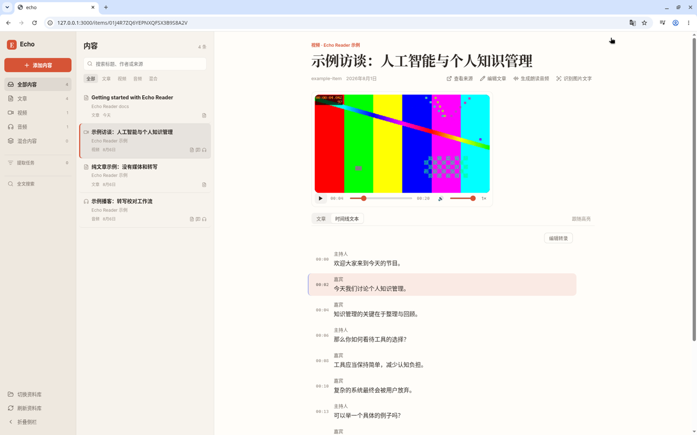
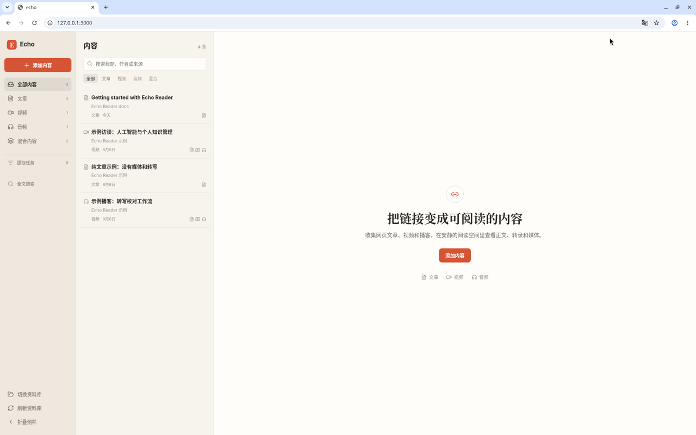
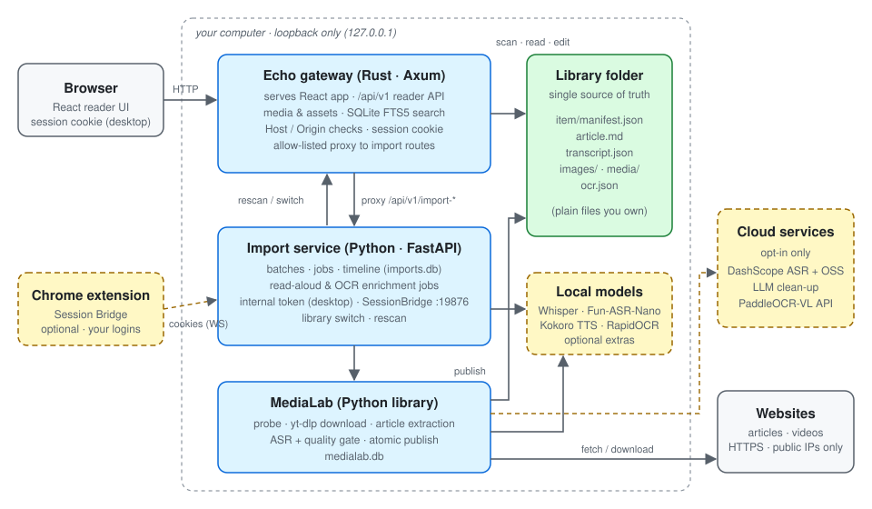
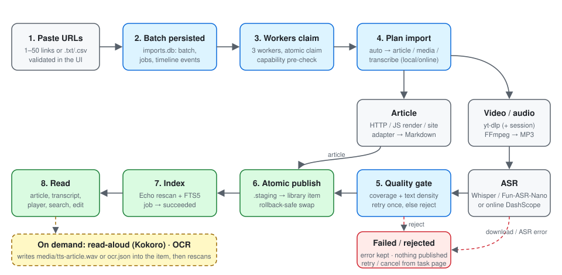
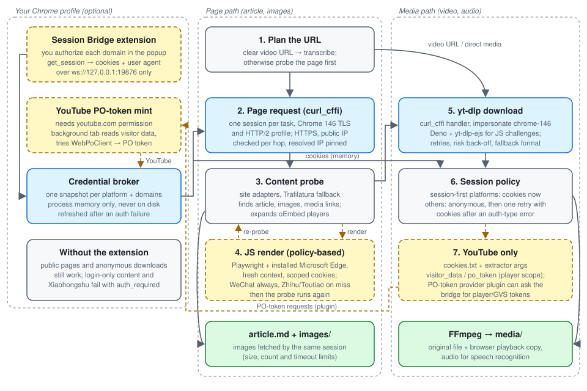
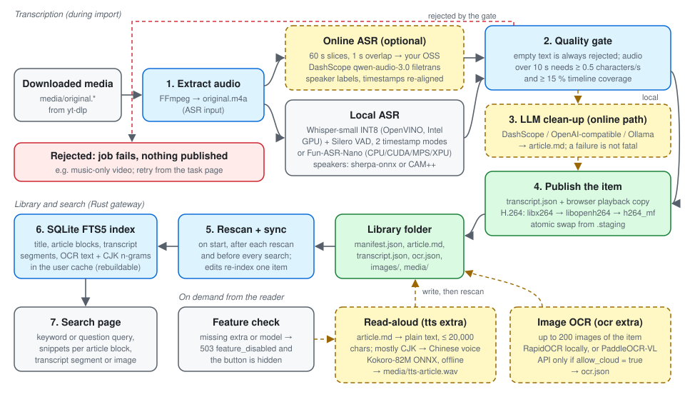

# Echo Reader

[English](README.md) | **简体中文**

[](LICENSE)
[](pyproject.toml)
[](components/echo/backend/Cargo.toml)
[](https://github.com/PakhomLeo/echo-reader)

Echo Reader 是一个本地优先的网页内容阅读应用。粘贴文章、帖子、播客或视频链接，它会把内容
保存为你磁盘上的普通文件（Markdown 正文、图片、媒体、带时间轴的转写），并提供阅读器、全文
检索、转写与播放器联动、Markdown 编辑，以及可选的朗读和图片文字识别（OCR）。

所有功能都在你自己的电脑上运行：没有账号、没有服务器、没有遥测。云端服务（在线语音识别、
大模型整理、云端 OCR）都是可选项，不配置就不会启用。

仓库地址：<https://github.com/PakhomLeo/echo-reader>。本项目（包名 `echo-reader`）与 GitHub 或其他地方
同名、近似名称的项目没有任何关系。



*阅读器中的一个视频条目：播放器暂停在 00:04，带说话人标签的转写里对应的那一句被高亮。示例条目是
`components/echo/library.example` 里自带的生成测试画面。*

## 目录

- [亮点](#亮点)
- [截图](#截图)
- [功能](#功能)
- [架构](#架构)
- [环境要求](#环境要求)
- [快速开始（Linux / macOS）](#快速开始linux--macos)
- [快速开始（Windows 源码）](#快速开始windows-源码)
- [可选依赖](#可选依赖)
- [配置](#配置)
- [安全模型](#安全模型)
- [负责任地使用](#负责任地使用)
- [常见问题](#常见问题)
- [开发与测试](#开发与测试)
- [项目状态](#项目状态)
- [文档](#文档)
- [参与贡献](#参与贡献)
- [许可证](#许可证)

## 亮点

- **一个链接，一个条目**：一个 URL 的正文、图片、视频、音频和转写都放进同一个文件夹，附带
  `manifest.json`；资料库文件夹是唯一的数据来源。
- **本地优先**：阅读、检索、本地语音识别、朗读和 OCR 都能离线使用；所有云端功能都需要你主动开启。
- **转写与播放联动**：点一句跳到对应时间，播放时自动高亮当前句，可直接编辑转写。
- **全部内容可全文检索**：标题、正文、转写和 OCR 文字都能搜，支持中日韩文字。
- **浏览器登录态由你掌控**：可选的 Chrome 扩展只为你授权的域名提供 Cookie，而且只交给本机导入服务。
- **只监听本机**：两个服务都拒绝非回环地址，并校验 `Host`、`Origin` 和 `Sec-Fetch-Site`。

## 截图



资料库视图：左侧栏有类型筛选（全部、文章、视频、音频、混合内容）、导入任务、全文搜索和切换资料库；
中间是条目列表；右侧是阅读区。两张截图都来自本机运行的实例，使用的是仓库自带的示例条目。

## 功能

### 导入

- 一次粘贴 1–50 个链接，或导入 `.txt` / `.csv` 文件，每个链接形成一个稳定的资料条目。
- 批次和任务保存在 SQLite（`imports.db`）里，重启后仍在，由 3 个 worker 执行。
- 任务开始前，导入服务会先检查所需能力（例如语音识别后端）是否可用，不可用就尽早失败并给出可读原因。
- 任务页按任务显示时间线，可以重试、取消或重新索引。
- 模式：`auto`（先探测页面，再抓取页面里的全部内容，最多 50 个媒体）、`article`、`download` 和
  `transcribe`。在 `auto` 模式下，明确的视频链接（YouTube、Bilibili、抖音、TikTok、Vimeo、Instagram
  Reels、X 帖子）直接进入转写。

### 正文抽取

- 页面用任务级 [curl_cffi](https://github.com/lexiforest/curl_cffi) 会话请求，呈现 Chrome 146 的 TLS
  和 HTTP/2 特征；不手写 User-Agent。
- 有微信公众号、小红书、知乎、今日头条、微博和 X/Twitter 的站点适配器，通用网页用
  [Trafilatura](https://trafilatura.readthedocs.io/) 兜底。死页和登录墙会被拒绝，不会被当成正文保存。
- 可选的 JavaScript 渲染：用 Playwright 驱动本机已安装的 Microsoft Edge，处理只在浏览器里加载内容的页面
  （微信始终渲染；知乎和头条只在静态页面没有正文时渲染）。
- 图片由同一个会话下载，数量（100 张）、大小（15 MiB）和超时都有上限。

### 视频与音频

- 通过 [yt-dlp](https://github.com/yt-dlp/yt-dlp) 下载（Bilibili、抖音、YouTube、X、TikTok、Vimeo、
  Twitch、Instagram、Facebook，以及处理媒体直链的通用 extractor），使用 yt-dlp 的 curl_cffi 处理器模拟
  Chrome，用 Deno + `yt-dlp-ejs` 处理 JavaScript 校验。
- 分层重试：yt-dlp 自带重试、遇到平台风控（HTTP 412/503）时退避重试，再用备用格式试一次。
- FFmpeg 保留原始文件，并生成浏览器可播放的副本（H.264 + AAC、MP3 或 M4A）。H.264 编码时，FFmpeg 有
  libx264 就用 libx264，否则用 libopenh264，再否则用 `h264_mf`。

### 语音识别

- **本地 Whisper**：OpenVINO Whisper-small INT8，运行在 Intel GPU 上，配合 Silero VAD 和匿名说话人分离
  （sherpa-onnx）。模型按固定 revision 下载。
- **本地 Fun-ASR-Nano**：FunASR，支持 CPU、CUDA、Apple MPS 或 Intel XPU，用 CAM++ 标注说话人。除非你设置
  `trust_remote_code = true`，否则从不执行模型仓库里的代码。
- **在线（可选）**：音频切成 60 秒一片、相邻片重叠 1 秒，上传到你自己的阿里云 OSS 存储桶，由 DashScope
  （`qwen-audio-3.0-asr-flash-filetrans`）转写；时间戳会换算回原始时间轴。
- **质量闸门**：转写为空一律拒绝；音频超过 10 秒时，还要求每秒至少 0.5 个字符、时间轴覆盖率至少 15%。
  本地 Whisper 会先换一种时间戳策略再试一次。被拒绝的任务不会发布任何内容。

### 大模型整理（可选）

- 在线转写完成后，可以用对话模型把带说话人的转写稿整理成可读的 `article.md`：DashScope（默认）、任意
  OpenAI 兼容接口，或本机 Ollama 模型。
- 英文内容会写成中文文章（原标题作为副标题保留）；已有的 `article.md` 不会被覆盖；整理失败时转写结果仍然保留。

### 阅读器

- React 19 界面，支持 Markdown 渲染、CodeMirror 6 编辑器和图片上传。
- 媒体播放器与转写联动（跳转、高亮），可编辑转写，正文和时间线文本分标签页显示。
- 侧栏可切换资料库，会做校验（不能是文件系统根目录，不能与 state、cache、config、日志或临时目录重叠），
  失败时回滚。

### 全文检索

- SQLite FTS5 索引，覆盖标题、正文段落、转写片段和 OCR 文字。
- 中日韩文字额外按 1–3 字的 n-gram 建索引，不需要词典就能匹配中文、日文和韩文词语。查询会加引号，
  防止注入；问句形式的查询会先提取关键词。
- 索引只是缓存：放在用户缓存目录里（从不放进资料库），在启动时、每次重新扫描后和每次搜索前同步，
  随时可以重建。

### 朗读（可选）

- 通过 `kokoro-onnx` 离线运行 [Kokoro-82M](https://huggingface.co/hexgrad/Kokoro-82M) 语音合成
  （`tts` extra）。模型文件单独下载，并用 SHA-256 校验。
- 正文先转成纯文本（跳过图片和代码块），最多 20,000 字；中日韩文字占多数时用中文音色，否则用英文音色。
- 结果保存为 `media/tts-article.wav`，作为条目的音频附件显示。

### 图片文字识别（可选）

- 本地使用 [RapidOCR](https://github.com/RapidAI/RapidOCR)，PP-OCR ONNX 模型随 wheel 提供（`ocr` extra）；
  只有在你明确设置 `allow_cloud = true` 时，才使用 PaddleOCR-VL 任务 API（模型 `PaddleOCR-VL-1.5`）。
- 每个条目最多识别 200 张图片，文字写入 `ocr.json` 并进入全文检索。

### 浏览器会话桥（可选）

- `components/medialab/browser-extension` 里的 Chrome MV3 扩展连接 `ws://127.0.0.1:19876`，返回*你*在
  弹窗里授权的域名的 Cookie。
- Cookie 保存在导入服务的内存里，只交给 curl_cffi 或 yt-dlp 用于单个任务；临时的 `cookies.txt` 用完即删，
  不会写进资料库。
- 对 YouTube，它还可以生成 visitor data 和 PO 令牌，见[负责任地使用](#负责任地使用)。

### Windows 桌面版

- 按用户安装的 Inno Setup 安装包和免安装程序束（`scripts\build-package.ps1`）。
- 宿主进程在动态回环端口上启动 Rust 网关和私有 Python 导入服务，每次启动生成随机会话 token，另有独立的
  内部 token，并处理单实例。用户数据放在 `%LOCALAPPDATA%\EchoReader` 和 `文档\Echo Reader Library` 下。

## 架构



仓库是一个 monorepo，包含两个相互独立的组件和一层集成：

| 路径 | 职责 | 技术栈 |
|---|---|---|
| `components/medialab` | 生产端：探测、下载、抽取、转写并发布条目 | Python 3.12、yt-dlp、curl_cffi、Trafilatura、OpenVINO / FunASR |
| `components/echo/backend` | 网关和阅读 API：扫描资料库、提供媒体、全文检索、代理导入 API | Rust、Axum、rusqlite（FTS5） |
| `components/echo/frontend` | 阅读界面 | React 19、Vite、CodeMirror 6 |
| `src/echo_reader` | 导入服务（批次、任务、增强处理）、桌面宿主、迁移 | FastAPI、SQLite |
| `components/medialab/browser-extension` | 可选的会话桥（Chrome MV3） | JavaScript |

**资料库文件夹是唯一的数据来源**：每个条目是一个目录，包含 `manifest.json`，以及可选的 `article.md`、
`transcript.json`、`images/`、`media/` 和 `ocr.json`。Echo 从不导入 MediaLab 的代码，反之亦然；两者之间的
约定是文件格式（[`components/echo/docs/file-format.md`](components/echo/docs/file-format.md)）和 HTTP API
（[`components/echo/docs/api.md`](components/echo/docs/api.md)）。

### 导入流程



### 抓取链路



各项网络技术在哪一步起作用：

| 步骤 | 技术 | 什么时候使用 |
|---|---|---|
| 页面请求 | Chrome 146 画像的 curl_cffi 会话 | 所有非媒体链接；每个任务一个会话，图片也用它下载 |
| 页面 Cookie | 会话桥 → 凭据代理 | 扩展已连接时的已知平台（通用网站不用）；小红书必须有 |
| JS 渲染 | Playwright + 本机已安装的 Microsoft Edge，每次新建上下文 | `[js_render].platform_modes`：微信 `always`，知乎 / 头条 `on_miss` |
| 媒体下载 | yt-dlp + curl_cffi 模拟（`chrome-146`） | 明确的视频链接、媒体直链和页面里发现的媒体 |
| 媒体 Cookie | 交给 yt-dlp 的 Netscape `cookies.txt` | `session_first_platforms` 里的平台一开始就用；其他平台只在出现认证类错误后才用 |
| YouTube visitor data / PO 令牌 | 扩展生成 → `youtube:visitor_data=…;po_token=…` extractor 参数；PO Token Provider 插件按需获取 player / GVS 令牌 | 仅 YouTube，且扩展有 `youtube.com` 权限时 |

所有对外请求都逐跳校验 HTTPS 和公网 IP，并固定解析结果。没有扩展或扩展拒绝时，公开内容照常可用，
需要登录的内容会以 `auth_required` 失败。

### 媒体处理链路



转写在导入时进行；朗读和 OCR 在阅读器里按需触发（条目上的“生成朗读音频”和“识别图片文字”）。结果写进条目
文件夹，再请网关重新扫描，同时刷新全文索引。

## 环境要求

- Python 3.12 和 [uv](https://docs.astral.sh/uv/)
- Rust（stable，edition 2024），以及 `rustfmt` 和 `clippy`
- 前端需要 [Bun](https://bun.sh/)，Vitest 需要 Node.js ≥ 22
- 导入音视频需要 `PATH` 中有 FFmpeg
- yt-dlp 处理 JavaScript 校验（YouTube 等）需要 [Deno](https://deno.com/)
- 可选：[mise](https://mise.jdx.dev) 按 `mise.toml` 安装固定版本的工具，包括 BtbN 的 "lgpl" 版 FFmpeg
  （它为什么不是纯 LGPL 构建，见 [FFmpeg](#ffmpeg)）
- 可选：JavaScript 渲染需要 Microsoft Edge；会话桥扩展需要 Chrome

本地 Whisper 识别通过 OpenVINO 使用 Intel GPU，不会悄悄回退到 CPU；Fun-ASR-Nano 可在 CPU、CUDA、
Apple MPS 或 Intel XPU 上运行。

## 快速开始（Linux / macOS）

```bash
git clone https://github.com/PakhomLeo/echo-reader.git echo-reader && cd echo-reader
uv sync                                   # Python 工作区（按需加 --extra local-asr 等）
(cd components/echo/frontend && bun install --frozen-lockfile && bun run build)
mkdir -p content .runtime

# 终端 1：导入服务（只监听本机回环地址）
uv run echo-reader-service --host 127.0.0.1 --port 3100 \
  --library-root content --runtime-root .runtime --echo-url http://127.0.0.1:3000

# 终端 2：Rust 网关 + 阅读界面，地址 http://127.0.0.1:3000
cd components/echo/backend
LIBRARY_ROOT=../../../content IMPORT_API_URL=http://127.0.0.1:3100 cargo run --release
```

打开 <http://127.0.0.1:3000>。前端开发时在 `components/echo/frontend` 运行 `bun run dev`（Vite 在 5173
端口，把 `/api` 代理到网关）。不导入任何内容也想先看看阅读器，可以把 `LIBRARY_ROOT` 指向
`components/echo/library.example` 的一份副本。

## 快速开始（Windows 源码）

```powershell
mise install
.\scripts\setup.ps1
.\scripts\run-reader.ps1
```

`scripts\build-package.ps1 -Version <x.y.z>` 构建免安装程序束；装有 Inno Setup 时还会构建按用户安装的
安装包。用目前固定的 FFmpeg 时，构建会在 FFmpeg 检查处停下，因为该构建含 FFTW（见 [FFmpeg](#ffmpeg)）。
详见 [docs/installation.md](docs/installation.md) 和 [docs/development.md](docs/development.md)。

## 可选依赖

| 功能 | 安装 | 说明 |
|---|---|---|
| 本地 Whisper 识别 | `uv sync --extra local-asr` | 首次使用时按固定 revision 下载 `OpenVINO/whisper-small-int8-ov` 并校验 |
| Fun-ASR-Nano 识别 | `uv sync --extra funasr` | 设置 `[local_asr].engine = "funasr_nano"`；会安装 PyTorch。默认不执行模型仓库代码（`trust_remote_code = false`） |
| 朗读 | `uv sync --extra tts`，再运行 `uv run python scripts/download_kokoro_models.py` | 下载约 350 MB 的 Kokoro v1.0 文件并校验固定的 SHA-256。该 extra 只会在你自己的电脑上安装 GPL-3.0 依赖（eSpeak NG、phonemizer-fork），本项目从不随附分发，见[许可证](#许可证) |
| 本地 OCR | `uv sync --extra ocr` | RapidOCR，PP-OCR ONNX 模型随 wheel 提供 |
| 云端 OCR | `[ocr] engine = "paddleocr_api"`、`allow_cloud = true`、HTTPS `endpoint`，token 写在 `secrets.toml` | **会把条目图片上传到所配置的服务** |
| 在线识别 / 大模型整理 | 把 `components/medialab/src/medialab/config/secrets.toml.example` 复制为 `config/secrets.toml` | 音频会上传到你的 OSS 存储桶和 DashScope；整理也可改用 OpenAI 兼容接口或本机 Ollama |
| JS 渲染 | 默认已安装 Playwright；Microsoft Edge 需自行安装 | 这里的 Playwright 从不下载浏览器。没有 Edge 时，微信导入会失败（微信必须渲染）；知乎和头条退回静态页面，并记录 `js_render_failed` 警告 |
| 会话桥 | 在 Chrome 中以“加载已解压的扩展程序”加载 `components/medialab/browser-extension` | 打开弹窗确认“已连接”，再授权需要的网站 |

缺少可选依赖或模型时，API 返回 `503 feature_disabled` 并说明原因，界面隐藏对应入口，其他功能不受影响。

### eSpeak NG（仅朗读需要）

eSpeak NG 是**由你自行安装的可选依赖**。只有 `uv sync --extra tts` 会引入它（经 `kokoro-onnx` →
内含 eSpeak NG 的 `espeakng-loader`，以及 `phonemizer-fork`），两者都是 GPL-3.0。Echo Reader **不分发**它：
它不在本仓库、我们的 wheel / sdist、Windows 安装包和程序束里（Windows 构建一旦发现它们就会失败）。
不安装 `tts` extra，你的电脑上就不会因为 Echo Reader 而出现任何 GPL 许可的组件，只是朗读功能不可用。

### FFmpeg

Echo Reader 把 `ffmpeg` 和 `ffprobe` 作为独立程序调用，`PATH` 里（或 `[audio].ffmpeg_path` 指定的）任何
较新的 FFmpeg 都能用。Echo Reader 自己的 MIT 代码不链接 FFmpeg。`mise install` 固定安装
[BtbN/FFmpeg-Builds](https://github.com/BtbN/FFmpeg-Builds) 的构建（`autobuild-2026-07-31-14-10`，FFmpeg
`release/8.1` 分支的 `n8.1.2-34-g9b6c8969e0`，`lgpl` / `lgpl-shared` 变体），资产名和 SHA-256 校验值都已
写死；它不含 libx264/libx265，用 OpenH264 编码 H.264。

**它不是纯 LGPL 构建。** BtbN 配置时没有用 `--enable-gpl` / `--enable-nonfree`，但它静态链接了 chromaprint，
而 BtbN 编 chromaprint 时用的是 FFTW 3.3.11（`-DFFT_LIB=fftw3`），FFTW 的许可证是 GPL-2.0-or-later。
Windows `lgpl-shared` 变体里 FFTW 在 `avformat-62.dll` 中，Linux 构建里同样有。这个构建还静态链接了其他
LGPL 库（LAME、soxr、libbluray 等）和 MPL-2.0 库（SRT、libzmq）。

因此，在 Echo Reader 改用我们自己编译、关闭 chromaprint 的精简 FFmpeg 之前，**不发布 Windows 安装包和
程序束**。`scripts/build-package.ps1` 发现 FFmpeg 可执行文件或 DLL 里含 FFTW 就会拒绝打包，所以目前固定的
构建无法打包。固定构建对应的 FFmpeg 源码和 BtbN 构建脚本挂在 GitHub Release 上。详情和后续计划见
[THIRD_PARTY_NOTICES.md](THIRD_PARTY_NOTICES.md)。

## 配置

### 配置文件和优先级

| 文件 | 用途 |
|---|---|
| `components/medialab/src/medialab/config/default_config.toml` | 带注释的默认配置（不要修改） |
| `config/config.toml` | 你的覆盖配置，节和键与默认配置相同（未被 Git 忽略，不要写入密钥） |
| `config/secrets.toml` | API key 和 token，从 `secrets.toml.example` 复制（已被 Git 忽略，切勿提交） |
| `config/app.json` | 在界面里选择的资料库文件夹（由应用写入，已被 Git 忽略） |

合并顺序为：默认配置 < `LIBRARY_ROOT` < `config.toml` < `secrets.toml`。源码模式下配置目录是
`<仓库>/config`；安装版使用 `%LOCALAPPDATA%\EchoReader\config`。

### 配置项一览

下表的默认值取自 `default_config.toml`。

| 键 | 默认值 | 说明 |
|---|---|---|
| `[concurrency] max_concurrent` | `3` | 每个流水线阶段（下载、抓取、识别、整理）各自的并发上限 |
| `[platforms] enabled` | Bilibili、抖音、YouTube、Twitter、TikTok、Vimeo、Twitch、Instagram、Facebook、`generic` | 允许使用的 yt-dlp extractor 正则 |
| `[paths] delivery` / `temp` / `db` | `""` / `"tmp"` / `"medialab.db"` | 资料库文件夹（空 = `content/` 或 `LIBRARY_ROOT`）、临时目录、MediaLab 任务库 |
| `[download] format` / `merge_output_format` | `"bv*+ba/b"` / `"mp4"` | yt-dlp 格式选择和封装格式 |
| `[download] retries` / `fragment_retries` / `concurrent_fragment_downloads` | `10` / `10` / `4` | yt-dlp 自带重试和分片并发 |
| `[download] risk_retries` / `risk_backoff_base` | `3` / `30` | 遇到 HTTP 412/503 时的额外尝试次数和基础退避秒数 |
| `[download] fallback_format` | `"b/best"` | 最后一次备用尝试使用的格式 |
| `[download] proxy` | `""` | yt-dlp 和在线识别使用的代理 |
| `[download] js_runtimes` / `remote_components` | `["deno"]` / `[]` | yt-dlp 处理 JS 校验的运行时；远程组件保持关闭 |
| `[download] session_first_platforms` | Bilibili、抖音、YouTube、X、TikTok、Vimeo、Twitch、Instagram、Facebook | 第一次尝试就带浏览器 Cookie 的平台 |
| `[article] direct_timeout` / `proxy` | `15` / `""` | 页面请求超时（秒）和代理 |
| `[article] min_text_chars` | `200` | 抽取文字少于这个字数且没有图片，视为“没有正文” |
| `[article] max_images` / `image_timeout` / `max_image_bytes` | `100` / `30` / `15728640` | 图片下载上限 |
| `[js_render] enabled` / `platform_modes` | `true` / `{wechat="always", zhihu="on_miss", toutiao="on_miss"}` | 按平台的 JS 渲染策略；未列出的平台从不渲染 |
| `[js_render] resource_domains` | 微信、QQ、知乎、头条的 CDN | 渲染页面允许加载资源的域名 |
| `[js_render] timeout_seconds` / `max_requests` / `max_bytes` | `20` / `80` / `10485760` | 渲染限制 |
| `[js_render] scroll_steps` / `scroll_delay_ms` | `6` / `300` | 滚动次数和间隔，用来触发懒加载 |
| `[content_capture] max_media_items` | `50` | `auto` 模式下每个链接最多抓取的媒体数；超过就明确失败 |
| `[audio] ffmpeg_path` | `""` | FFmpeg 路径；空 = 配置路径 → `PATH` → mise |
| `[progress] throttle` | `1.0` | 进度事件的最小间隔（秒） |
| `[oss] presign_expires` / `max_batches` / `ttl_seconds` | `86400` / `10` / `10800` | 签名 URL 有效期（秒）；已上传的切片按“保留最近 10 个任务批次、不超过 3 小时”清理 |
| `[oss] slice_seconds` / `overlap_seconds` | `60` / `1` | 在线识别的切片长度和重叠 |
| `[asr] model` / `language_hints` | `"qwen-audio-3.0-asr-flash-filetrans"` / `["zh", "en"]` | 在线识别模型和语言提示 |
| `[asr] diarization_enabled` / `speaker_count` | `true` / `0` | 在线说话人标注；0 = 自动判断人数 |
| `[asr] poll_interval` / `poll_max_interval` / `max_wait_seconds` / `slice_concurrency` | `2.0` / `5.0` / `1800` / `3` | 在线任务的轮询和并发 |
| `[local_asr] engine` | `"openvino_whisper"` | `openvino_whisper` 或 `funasr_nano` |
| `[local_asr] model_id` / `revision` / `model_dir` / `cache_dir` | `OpenVINO/whisper-small-int8-ov` / 固定提交 / `.runtime/models/local-asr` / `.runtime/cache/openvino/local-asr` | Whisper 模型、固定 revision 和存放位置 |
| `[local_asr] device` / `auto_download` | `"GPU"` / `true` | OpenVINO 设备；首次使用时下载模型 |
| `[local_asr] vad_*`、`cluster_threshold`、`diarization_*` | 见配置文件 | Silero VAD 和 sherpa-onnx 说话人分离的调参 |
| `[local_asr.funasr] model` / `model_revision` | `FunAudioLLM/Fun-ASR-Nano-2512` / `""` | Fun-ASR-Nano 模型和可选的固定提交 |
| `[local_asr.funasr] trust_remote_code` | `false` | 设为 `true` 会让 FunASR 安装并导入模型仓库里的代码，只在审阅过仓库后开启 |
| `[local_asr.funasr] hub` / `auxiliary_hub` | `"hf"` / `"ms"` | 模型来自 Hugging Face，VAD / 说话人模型来自 ModelScope |
| `[local_asr.funasr] vad_model` / `punc_model` / `spk_model` / `spk_mode` | `fsmn-vad` / `""` / `cam++` / `vad_segment` | 辅助模型 |
| `[local_asr.funasr] device` / `language` / `hotwords` | `"auto"` / `"auto"` / `[]` | 设备、语言和热词 |
| `[refine] enabled` / `provider` | `true` / `"dashscope"` | 在线识别后的大模型整理：`dashscope`、`openai_compatible` 或 `ollama` |
| `[refine] model` / `base_url` | `""` / `""` | DashScope：留空时使用 DashScope 兼容接口上的 `qwen3.7-flash`；Ollama：必须填 `model`，`base_url` 默认 `http://127.0.0.1:11434/v1`；OpenAI 兼容：两者都必填 |
| `[refine] temperature` / `max_input_chars` / `max_tokens` / `shrink_threshold` | `0.3` / `24000` / `12000` / `2` | 生成和分块限制 |
| `[refine] timeout_seconds` / `max_retries` | `300` / `2` | 请求超时和重试次数 |
| `[refine] speaker_label` / `zh_threshold` | `"说话人"` / `0.2` | 说话人前缀；汉字占比低于该值时视为英文内容 |
| `[tts] enabled` / `model_dir` | `true` / `""` | 朗读开关；目录留空 = `<cache>/models/kokoro`（`ECHO_TTS_MODELS_PATH` 优先） |
| `[tts] voice` / `voice_zh` / `speed` | `"af_heart"` / `"zf_xiaoxiao"` / `1.0` | 英文音色、中文音色、语速 |
| `[ocr] enabled` / `engine` | `true` / `"auto"` | `auto`（装了 RapidOCR 就用它，否则在允许时用云端 API）、`rapidocr` 或 `paddleocr_api` |
| `[ocr] allow_cloud` / `endpoint` / `model` / `max_poll_attempts` | `false` / PaddleOCR 任务 API / `"PaddleOCR-VL-1.5"` / `60` | 只有 `allow_cloud = true` 且地址为 HTTPS 时才使用云端 OCR |

### 密钥（`config/secrets.toml`）

| 键 | 用途 |
|---|---|
| `[oss] access_key_id`、`access_key_secret`、`region`、`endpoint`、`bucket`、`prefix` | 在线识别上传；所有键都填写后才启用 OSS |
| `[asr] api_key`、`base_url` | DashScope 识别（`[refine] api_key` 为空时也用于 DashScope 整理） |
| `[refine] api_key` | 不在本机的 OpenAI 兼容接口；Ollama 不需要 |
| `[ocr] token` | PaddleOCR API |

### 环境变量

| 变量 | 组件 | 说明 |
|---|---|---|
| `LIBRARY_ROOT` | 网关、导入服务 | 资料库文件夹 |
| `IMPORT_API_URL` | 网关 | 导入服务地址（默认 `http://127.0.0.1:3100`，只能是回环地址） |
| `ECHO_BIND` | 网关 | 监听地址（默认 `127.0.0.1:3000`，只能是回环地址） |
| `ECHO_WEB_ROOT` | 网关 | 前端构建产物目录（默认 `components/echo/frontend/dist`） |
| `ECHO_SEARCH_INDEX` / `ECHO_CACHE_DIR` | 网关 | 搜索索引文件 / 默认索引路径所用的缓存目录 |
| `ECHO_PUBLIC_TOKEN` | 网关 | 浏览器会话 token（由桌面宿主设置） |
| `ECHO_INTERNAL_TOKEN` | 网关、导入服务 | 网关与私有导入服务之间的 token（由桌面宿主设置） |
| `ECHO_BOOT_ID`、`ECHO_HOST_PID`、`ECHO_READY_FILE` | 网关 | 桌面宿主集成 |
| `ECHO_READER_LIBRARY_ROOT`、`ECHO_READER_CONFIG_ROOT`、`ECHO_READER_STATE_ROOT`、`ECHO_READER_CACHE_ROOT`、`ECHO_READER_LOGS_ROOT`、`ECHO_READER_TMP_ROOT` | 导入服务 | 分别覆盖各个数据目录 |
| `ECHO_READER_INSTALL_MODE` | 导入服务 | `1` = 使用安装版的目录布局 |
| `ECHO_TTS_MODELS_PATH` | 导入服务 | Kokoro 模型目录 |

`echo-reader-service` 支持 `--host`、`--port`、`--library-root`、`--runtime-root`、`--state-root`、
`--cache-root`、`--logs-root`、`--tmp-root`、`--config-root`、`--install-mode`、`--echo-url` 和
`--internal-token`。`echo-reader-import <url>` 可以在命令行导入单个链接。

## 安全模型

Echo Reader 是单用户本机应用。

- 网关和导入服务都拒绝监听非回环地址；拒绝 `Host` 不是回环地址的请求（防 DNS rebinding）；
  对修改状态的请求，拒绝 `Sec-Fetch-Site: cross-site` 和不匹配的 `Origin`。
- 桌面版另外为每次启动生成随机会话 token（HttpOnly、SameSite=Strict Cookie），所有页面和 API
  都需要它；网关与私有导入服务之间使用另一个内部 token。
- 对外抓取逐跳校验 HTTPS 与公网 IP，并固定解析结果。
- 会话桥借来的 Cookie 只保存在进程内存中。

发现漏洞请按 [SECURITY.md](SECURITY.md) 私下报告。

## 负责任地使用

Echo Reader 是个人阅读和笔记工具，如何使用由你自己负责。

- **只导入你有权访问和复制的内容。** 遵守著作权、各网站的服务条款以及 robots / 频率限制。
  为个人学习保存副本，不代表你有权再次发布。
- **不要用它绕过付费墙、DRM、访问控制或地区限制**，也不要用于批量爬取、镜像或再分发。
- **会话桥使用的是你自己的浏览器登录态。** 只授权你自己的网站和账号，保持扩展的授权域名单尽量小；
  用你的账号进行自动化访问可能违反网站条款，账号可能因此受限。
- **YouTube PO Token 生成（mint）。** YouTube 有时要求下载请求带上与真实浏览器会话一致的“来源证明”
  （PO）令牌和 visitor data，否则拒绝下载。给浏览器扩展授予 `youtube.com` 访问权限后，yt-dlp 可以经本地会话桥
  请求扩展：在**你自己的** Chrome 配置里打开一个后台 YouTube 标签页，读取页面上的 visitor data，并尽可能
  在页面内生成 PO 令牌。令牌和 visitor data 交给 yt-dlp 用于下载，只保存在导入服务的内存里，不写入磁盘；这个请求只接受 YouTube 视频地址或视频 ID。
  这样下载请求看起来就像来自你登录的浏览器，这可能与 YouTube 服务条款（除 YouTube 提供的下载方式外
  限制下载）相冲突。**是否允许这样使用（例如你自己上传的视频、知识共享许可视频或已获授权的内容），
  以及对账号造成的后果，完全由你自己负责。** 如果不想使用，不要给扩展授予 `youtube.com` 权限（或不安装扩展），
  Echo Reader 的其他功能不受影响。
- **转写、说话人标签、OCR 和大模型输出都是机器生成的，可能出错。** 说话人分离只给出匿名编号，
  不是声纹识别，不要用它识别具体的人。引用或依赖重要文字前请先人工核对。
- **云端功能会把数据发给第三方。** 在线识别把音频上传到你的 OSS 和 DashScope；云端 OCR 上传图片；
  大模型整理把转写文本发给你配置的服务商。不要对你无权分享的机密或个人数据启用这些功能。
- **资料库里的个人信息由你负责。** 导入的内容可能包含他人的个人信息，请按适用法律（例如《个人信息
  保护法》、GDPR）处理。
- 朗读音频使用 Kokoro 的合成音色，不要把它冒充成真人的声音。

## 常见问题

**导入失败，提示 `auth_required`，怎么办？**
这个页面或视频需要登录。在 Chrome 中加载会话桥扩展，确认弹窗显示已连接，授权该网站，然后在任务页重试。
小红书始终需要这样做。

**YouTube 提示 “Sign in to confirm you're not a bot”。**
给扩展授予 `youtube.com` 权限，导入时才能使用你的会话、visitor data 和 PO 令牌。请先阅读
[负责任地使用](#负责任地使用)；如果不想这样做，YouTube 导入可能失败。

**导入弹窗里本地识别和在线识别都显示“不可用”。**
两个识别后端都没有配置。安装 `--extra local-asr`（Intel GPU）或 `--extra funasr`（CPU/GPU），或在
`config/secrets.toml` 中填写 OSS 和 DashScope 密钥。

**一个音乐视频被质量闸门拒绝了。**
这是有意的：几乎没有文字的转写不会被当作成功发布。如果只想要媒体文件，请用 `download` 模式。

**微信文章导入失败，提示 JS 渲染错误。**
微信页面始终需要渲染，才能拿到懒加载的图片和媒体。请安装 Microsoft Edge（Playwright 使用本机已安装的浏览器，
从不自行下载）后重试。

**我的文件在哪里？能挪位置吗？**
每个条目都是资料库里的普通文件夹（源码模式下是 `content/`，安装版是 `文档\Echo Reader Library`）。用侧栏的
“切换资料库”或 `LIBRARY_ROOT` 指向别处即可。搜索索引只是缓存，会自动重建。

**朗读或 OCR 按钮不见了。**
说明该功能不可用。`GET /api/v1/features` 会给出原因；安装 `tts` 或 `ocr` extra，朗读还需要下载 Kokoro 模型文件。

**OCR 会上传我的图片吗？**
默认不会。只有在 `[ocr] allow_cloud = true` 并配置了 HTTPS 地址和 token 时，图片才会发送到 PaddleOCR API；
否则在本地用 RapidOCR 识别。

**能从局域网里的其他设备打开阅读器吗？**
不能。两个服务都只监听回环地址，并拒绝外部的 `Host` 请求头。Echo Reader 是单用户本机应用。

**FFmpeg 必须带 libx264 吗？**
不需要。任何较新的 FFmpeg 都能用；生成播放副本时有 libx264 就用，否则用 libopenh264 或 `h264_mf`。
`mise.toml` 里固定的构建就够用。

**这个项目和其他叫 Echo 或 Echo Reader 的项目有关吗？**
没有。本项目与使用相同或近似名称的其他项目没有任何关系。

## 开发与测试

```bash
CARGO_BUILD_JOBS=2 bash scripts/verify.sh       # pytest、cargo fmt/clippy/test、类型检查、oxlint、vitest、构建
bash scripts/verify.sh --e2e                    # 额外运行 Playwright
```

Windows 上使用 `scripts\verify.ps1`。贡献流程见 [CONTRIBUTING.md](CONTRIBUTING.md)。

## 项目状态

导入、阅读、检索和 Windows 打包的核心路径都有单元测试和集成测试。站点适配器依赖第三方页面结构，
网站改版后可能失效。当前版本 0.1.0，暂不承诺接口稳定。

已知限制：

- 本地 Whisper 需要 Intel GPU，这个引擎没有 CPU 回退。
- 目前不发布 Windows 安装包和程序束：固定的 FFmpeg 构建含 GPL 的 FFTW（见 [FFmpeg](#ffmpeg)），
  安装包也还没有在干净的机器上构建和测试过。
- 朗读链路依赖 GPL-3.0 软件包；计划换成不依赖 eSpeak 的 G2P。

## 文档

| 文档 | 内容 |
|---|---|
| [docs/README.md](docs/README.md) | 文档索引（多数设计文档为中文） |
| [docs/installation.md](docs/installation.md) | Windows 安装、数据目录、迁移 |
| [docs/development.md](docs/development.md) | 开发环境和打包 |
| [docs/architecture.md](docs/architecture.md) | 架构说明 |
| [components/echo/docs/file-format.md](components/echo/docs/file-format.md) | 资料条目格式 |
| [components/echo/docs/api.md](components/echo/docs/api.md) | 阅读器 HTTP API |
| [components/medialab/browser-extension/README.md](components/medialab/browser-extension/README.md) | 会话桥协议和安全边界 |

## 参与贡献

欢迎在 <https://github.com/PakhomLeo/echo-reader/issues> 提交 issue 和 pull request。请先阅读
[CONTRIBUTING.md](CONTRIBUTING.md)；安全问题请按 [SECURITY.md](SECURITY.md) 私下报告。

## 许可证

Echo Reader 以 [MIT 许可证](LICENSE) 发布。

第三方组件保留各自的许可证，见 [THIRD_PARTY_NOTICES.md](THIRD_PARTY_NOTICES.md)。需要特别注意：

- **eSpeak NG 和 `phonemizer-fork` 使用 GPL-3.0。** 只有可选的 `tts` extra 会引入它们（`kokoro-onnx`
  → 内置 eSpeak NG 的 `espeakng-loader`，以及 `phonemizer-fork`）。它们是**由用户自行安装的可选依赖**，
  本项目**不分发**它们：不在本仓库中，不在我们构建的 wheel / sdist 中，也不在 Windows 安装包、免安装
  程序束或任何其他 bundle / sidecar 中——Windows 构建会显式排除它们，一旦出现即构建失败。如果你再分发
  包含它们的环境，该分发须遵守 GPL-3.0；
- **FFmpeg**：Echo Reader 的 MIT 代码只把 `ffmpeg` / `ffprobe` 当独立程序调用，不链接 FFmpeg。
  `mise.toml` 固定的 BtbN "lgpl" 构建**不是**纯 LGPL 构建：它经 chromaprint 静态链接了 GPL-2.0-or-later
  的 FFTW。在换成关闭 chromaprint 的自编精简 FFmpeg 之前，不发布 Windows 安装包和程序束（见
  [FFmpeg](#ffmpeg)）；
- 模型权重（Whisper、Kokoro-82M、Fun-ASR-Nano、PP-OCR）在运行时下载，许可证由各自作者规定
  （Apache-2.0 / MIT）。
