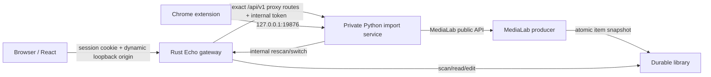

# 架构说明

## 边界

Echo Reader 是一个 monorepo，但两个组件仍可独立运行：

- `components/medialab`：Python 内容生产者，负责探测、下载、文章抽取、ASR 和标准 item 发布。
- `components/echo`：Rust/Axum API 和 React 阅读器，只理解共享资料库格式。
- `src/echo_reader`：宿主与集成层，负责持久导入批次、AppPaths、切库、迁移和进程生命周期。

MediaLab 和 Echo 不相互 import 内部模块。`LIBRARY_ROOT` 下的文件是数据面；Echo
`/api/v1` 是控制面。集成层只调用 MediaLab 公开 Python API 和 Echo 的 rescan/switch HTTP 接口。

## 安装版进程和同源网关

Python 宿主保留一个动态 loopback socket 给私有 import service，再启动 Rust 子进程。Rust
绑定另一个动态 loopback 端口，同源托管 React、Echo API 以及导入 API 的精确白名单代理。
浏览器不知道 Python 端口或内部 token。两个 HTTP client 均禁用环境代理，Rust 不跟随 Python
上游重定向。

宿主为每次运行生成公开 session token 和独立内部 token。浏览器只通过 `/session/{token}`
bootstrap 获得 session-only、HttpOnly、SameSite=Strict cookie；除 `/health` 和内部路由外，Rust
的 API、SPA、静态文件与媒体都要求该 cookie。Rust 在所有请求上还要求 loopback Host；修改
状态的请求拒绝 cross-site `Sec-Fetch-Site` 和不匹配 Host 的 Origin。Rust 代理给 Python 时注入
内部 token，Python 安装模式对全部端点验证它，因此直接连接私有端口不能绕过网关。

SessionBridge 扩展合同固定为 `127.0.0.1:19876`，所以 Windows mutex 实现每机器单实例。
再次启动通过带 boot ID 的健康检查打开现有实例，而不是共享两套 SQLite/模型进程。

## 持久状态

`AppPaths` 是宿主路径权威。源码模式使用仓库 `content/`、`.runtime/`、`config/`；安装模式
使用 Documents 已知文件夹中的资料库和 `%LOCALAPPDATA%\EchoReader` 下的
state/cache/config/logs/tmp。安装目录无持久用户数据，可整体替换。
持久 `app.json` 在启动时也执行非文件系统根与持久控制目录 overlap 校验；无效配置明确失败，
不会先以危险 root 启动再等待用户切换。

Echo 索引位于内存和文件系统；`imports.db` 保存 batch/job/event，`medialab.db` 保存生产任务
与 ASR 数据。imports schema v2 用 `library_key + item_path` 表示成功产物；`item_path` 必须是当前
资料库内的安全相对路径，不保存可失效的机器绝对 `out_dir`。

切库与 rescan 都在各自服务内串行化。根宿主在一个 state lock 内拒绝活动导入，验证路径
不与其他持久根重叠，初始化新协调器、切换 Echo、持久 `app.json`，任一步失败即恢复
旧 Echo root 并关闭新协调器。

## 生命周期

只有空闲应用接受 UI shutdown。正常停止有宽限，超过导入服务硬截止时会先将活动 job
写为 `interrupted`，再以非零状态结束异常宿主。Rust 子进程监视宿主 PID；宿主被强杀后
它主动关闭，超过截止则自行强制结束。这些截止是崩溃边界，不会把仍在运行的原生
ASR 伪装成已取消的成功任务。

## 独立性

Echo 可以单独读取任何符合格式的资料库；MediaLab 可以单独写任意 delivery root。
安装版的动态端口、单实例和代理层是宿主形态，不改变组件公开边界。
